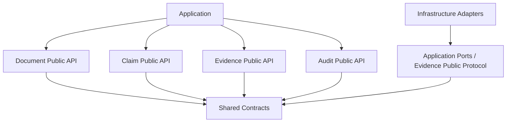

# Evidence Check｜架构蓝图与软件蓝图 V0.1

> 状态：设计基线（供 POC 分阶段开发）；不是已通过 POC 的产品化架构。  
> 输入基线：《医学论文证据链审计器 PRD v1.0》《Evidence Check 预研技术方案一页纸》、`annotation-schema.json`、`labeling-guide.md`、`README(20261017-115350).md`。  
> 本文件合并领域建模、目录、模块契约、业务规则配置四阶段；阶段 5（编码）和阶段 6（代码审计）未执行。

## 0. 执行摘要与边界

**产品目标：** 用户提交单章节医学论文、参考文献表及已引用全文 PDF；系统检查 Claim 的引文完整性、引用可解析性、证据是否可定位、限定范围/因果强度/方向/数值是否存在风险，输出逐条可复核的审计提示，而非替用户写论文或裁定医学结论。

**首版边界：** DOCX/Markdown、单章节（中文 ≤5,000 字或英文 ≤3,000 words）、顺序编码数字引文、≤30 篇参考文献、文本型 PDF。只检索正文已经引用且有可审计全文的文献；无全文、扫描不可读、图表不可可靠解析则标记不可审计。初版不做全篇、联网补文献、医疗建议、查重/AI 检测、论文打分、向量库、知识图谱或通用 Agent 框架。

**总体决策：** 单体模块化，四个业务域（Document、Claim、Evidence、Audit）+ Application + Infrastructure；Python/FastAPI，Next.js 薄前端；BM25 本地任务索引，可选语义重排；LLM 只产生候选及语义比对事实，不直接产生最终 Finding；规则执行负责映射、来源门禁与保守降级。POC-A 先实现引用完整性，POC-B 再做 Claim–Evidence 对齐；暂不直接产品化。

### 0.1 冻结 / 待验证

| 类型 | 内容 |
|---|---|
| 基线约束 | 封闭引用语料、证据原文与页码可定位、五标签八规则、无全文不作支持性判断、不得由 LLM 直接生成最终 Finding |
| 设计决策 | 四域单体模块化、公开 `api.py`、共享 DTO、配置化规则、Adapters 防腐层 |
| POC 假设 | BM25 的中英跨语召回效果、语义比对可靠性、混合多引用聚合能力、处理性能、用户付费意愿 |
| 待冻结细节 | 比较事实枚举和冲突决策表、混合语言长度计数、文件丢失处理、指标分母及盲测抽样规则 |

## 1. 领域建模

### 1.1 领域职责

| 域/层 | 职责 | 不负责 |
|---|---|---|
| Document | 正文结构、句子坐标、数字引用、reference 映射与可用性 | 医学结论判断、PDF 读写 SDK |
| Claim | 候选 Claim 校验、标准化、限定项、原文与引文绑定 | 模型推理 SDK、检索、终审 |
| Evidence | 在许可引用文献中寻找和核验原文证据段、定位 | 额外联网找文献、终审 |
| Audit | 基于比对事实和可审计性运行规则、生成 Finding | 检索、LLM 直接调用、数据库 |
| Application | 提交任务、步骤编排、模型端口调用、报告组织、失败与删除调度 | 领域内部算法 |
| Infrastructure | DOCX/PDF/Markdown 读取、BM25、LLM、数据库、对象/文件存储 | 业务决策 |
| Contracts | 跨域 DTO、共用枚举、位置和来源标识 | 依赖任何业务域 |

### 1.2 实体、标识与粒度

| 对象 | 主要字段（`?` 可选） | 来源/粒度 |
|---|---|---|
| `AuditTask` | `task_id,status,source_document_id` | 一次任务 |
| `TextLocation` | `section?,paragraph_index?,sentence_index?,char_start?,char_end?` | 论文原文定位 |
| `DocumentBundle` | `document_id,sentences,citations,references` | 单章节 |
| `CitationRecord` | `citation_id,location,reference_id?` | 一个引文编号及锚点 |
| `ReferenceRecord` | `reference_id,source_file_id?,availability` | 一条参考文献 |
| `ClaimRecord` | `claim_id,claim_text,claim_type,citation_ids,location,assertion_strength?,qualifiers?` | 一条可核查论断 |
| `EvidenceSpan` | `reference_id,source_file_id,page,paragraph?,text` | PDF 中可定位的原文片段 |
| `EvidenceBundle` | `claim_id,candidates,retrieval_status` | Claim 的候选集合 |
| `ComparisonFacts` | `claim_id,evidence_refs,scope_relation?,causal_relation?,direction_relation?,numeric_relation?,comparison_status` | Claim/证据候选比对 |
| `AuditDecision` | `claim_id,final_label,rule_ids,findings` | 一条 Claim 的决策 |

`citation_id` 是文内顺序编码（如 `[3]`），`reference_id` 是对应文献条目，`source_file_id` 是用户上传的 PDF；三者不得混用。`EvidenceSpan` 是原文候选，不隐含支持性。`annotation-schema.json` 规定人工金标的字段与枚举，运行预测和人工金标不能共享同一个结果字段进行覆盖；定义显式转换接口。

现有 Schema 枚举必须保持：
- `claim_type`: `prevalence, association, causality, effectiveness, safety, prognosis, diagnostic_accuracy`。
- `final_label`: `supported, partially_supported, contradicted, unverified, not_assessable`。
- `rule_ids`: `missing_citation, unresolved_reference, source_unavailable, unsupported_claim, scope_mismatch, causality_overclaim, direction_mismatch, numeric_mismatch`。
- `language_mode`: `zh-zh, zh-en, en-en`。

### 1.3 模块依赖 DAG（箭头为源码依赖，而非数据流向）



Application 的装配层向外部端口注入 Adapter；Domain 不引用 Infrastructure；Domain 之间不引用内部实现；`contracts` 和任何 `common` 不引用领域。禁止循环依赖；后续以 import-linter 等检查实际导入关系。

## 2. 工程目录（JSON）

目录为目标设计，不要求自动生成无用占位模块；`main.py` 只做应用装配。

```json
{
  "backend": {
    "src": {"evidence_check": {
      "main.py": "FastAPI assembly only",
      "contracts": {"models.py": "shared DTO", "enums.py": "shared enums"},
      "application": {
        "api.py": "application facade",
        "orchestration": {"audit_workflow.py": "workflow", "task_service.py": "task lifecycle"},
        "ports": {"llm_port.py": "candidate/comparison interface", "file_port.py": "file storage", "task_repository_port.py": "task persistence"},
        "web": {"routes.py": "HTTP routes", "schemas.py": "HTTP DTO"}
      },
      "domains": {
        "document": {"api.py": "public interface", "domain": {"models.py": "domain types", "citation_parser.py": "numeric anchors", "reference_resolver.py": "citation resolution", "document_service.py": "document normalization"}},
        "claim": {"api.py": "public interface", "domain": {"models.py": "internal types", "claim_service.py": "candidate validation"}},
        "evidence": {"api.py": "public interface and retrieval protocol", "domain": {"models.py": "internal types", "retrieval_service.py": "allowed-reference retrieval", "evidence_service.py": "source validation"}},
        "audit": {"api.py": "public interface", "domain": {"models.py": "internal types", "comparison.py": "fact validation", "rule_engine.py": "config rule evaluation", "audit_service.py": "decisions"}}
      },
      "infrastructure": {
        "documents": {"docx_adapter.py": "DOCX", "markdown_adapter.py": "Markdown", "pdf_adapter.py": "PDF"},
        "llm": {"llm_adapter.py": "LLM SDK adapter"},
        "retrieval": {"bm25_adapter.py": "BM25 implementation"},
        "persistence": {"task_repository.py": "database adapter", "file_storage.py": "file adapter"}
      }
    }},
    "config": {"audit_rules.yml": "label/severity policies", "retrieval.yml": "source scope/index tuning", "limits.yml": "limits/retention"},
    "tests": {"unit": "domain tests", "contract": "DTO/schema compatibility", "integration": "workflow tests", "architecture": "dependency checks"},
    "pyproject.toml": "dependencies and quality tools"
  },
  "frontend": {"app": {"page.tsx": "upload", "audit": {"[taskId]": {"page.tsx": "results"}}}, "components": {"UploadForm.tsx": "upload", "FindingList.tsx": "finding list"}, "lib": {"api.ts": "HTTP client"}},
  "evaluation": {"annotation-schema.json": "gold-label schema", "labeling-guide.md": "manual labeling", "annotation-template.jsonl": "blank annotation tasks"},
  "docs": {"PRD.md": "product scope", "architecture.md": "this blueprint", "contracts.md": "API contract index"}
}
```

## 3. 业务主链与接口契约

```text
任务提交/安全门禁
→ Infrastructure 读取 DOCX/Markdown、参考文献、已上传 PDF
→ Document.parse_document(DocumentInput) -> DocumentBundle
→ POC-A: 引文确定性规则与定位报告
→ [仅 POC-B] Application 调 LLM.extract_claims -> ClaimCandidate[]
→ Claim.normalize_claims(DocumentBundle, ClaimCandidate[]) -> ClaimRecord[]
→ Evidence.retrieve_evidence(ClaimRecord[], DocumentBundle, EvidenceRetrieverPort) -> EvidenceBundle[]
→ Application 调 LLM.compare_evidence(ClaimRecord, EvidenceBundle) -> ComparisonFacts
→ Audit.evaluate_audit(ClaimRecord, EvidenceBundle, ComparisonFacts, LoadedPolicy) -> AuditDecision
→ Application 生成 Markdown/HTML 报告、控制删除任务
```

`LoadedPolicy` 是从三份配置加载并通过 Schema 验证的**不可变只读配置快照**；配置版本写入任务追踪记录。它是注入对象，不是 Audit 读取 YAML 文件的能力。此为针对前期 `evaluate_audit` 签名的必要澄清。

### 3.1 四个公开 API

| 域 | 输入 | 输出 | 错误/边界 |
|---|---|---|---|
| `Document.parse_document` | `DocumentInput`（格式适配后的正文、参考文献、全文可用性） | `DocumentBundle` | 编号错配记录为问题；解析完全失败为任务失败 |
| `Claim.normalize_claims` | `DocumentBundle, ClaimCandidate[]` | `ClaimRecord[]` | 候选必须可定位于原文；拒绝编造、越界坐标 |
| `Evidence.retrieve_evidence` | `ClaimRecord[], DocumentBundle, EvidenceRetrieverPort` | `EvidenceBundle[]` | 只允许已解析引用的可读全文；位置无法复核即无效候选 |
| `Audit.evaluate_audit` | `ClaimRecord, EvidenceBundle, ComparisonFacts, LoadedPolicy` | `AuditDecision` | 无法判断允许 UNKNOWN；不可把缺证据等同反证 |

**公开协议**：EvidenceRetrieverPort 定义一次查询与返回 EvidenceSpan 的结构；BM25 Adapter 实现此协议并通过 Application 注入。业务层只依赖公开协议。

### 3.2 LLM Port（仅两个操作）

- `extract_claims(document_context) -> ClaimCandidate[]`：候选 Claim、原文位置、类别、断言强度和限定项；返回 JSON Schema 约束结构。Claim Domain 复查原文。
- `compare_evidence(claim,evidence_spans) -> ComparisonFacts`：对范围、因果、方向、数值给出结构化比对候选及证据引用；必须允许 `unknown`，禁止给最终 `final_label`、`rule_id`、`Finding`。

**精度边界：** Python 可验证来源、字段、页码及文本匹配，不能仅凭这些校验证明模型语义判断正确；语义型 Finding 要有人工金标集盲测。

### 3.3 流程异常与审计轨迹

| 情况 | 行为 |
|---|---|
| 无数字引用、编号无法解析 | 明确的规则 Finding，标签 `not_assessable` |
| 被引 PDF 缺失/不可读取 | 该来源 `not_assessable`；并非整个任务必然失败 |
| 全文可审计但无足够证据 | `unverified`，不等于“错误” |
| 有定位明确的相反证据 | 符合其他准入约束时可判 `contradicted` |
| LLM/存储/代码运行故障 | 任务失败或步骤失败；**不**伪装成 `unverified` |

每次任务记录 `task_id`、步骤、耗时、异常码、模型/提示词/规则版本、输入哈希和删除结果；日志默认不落完整论文或证据原文。原始文件与解析文本默认保留 24 小时，删除失败需记录并重试。

## 4. 配置规范：三个 YAML

### 4.1 `backend/config/audit_rules.yml`（草案）

```yaml
version: '0.1'
labels: [supported, partially_supported, contradicted, unverified, not_assessable]
rules:
  missing_citation: {enabled: true, when: citation_missing, label: not_assessable, severity: warning}
  unresolved_reference: {enabled: true, when: reference_unresolved, label: not_assessable, severity: error}
  source_unavailable: {enabled: true, when: cited_source_unavailable, label: not_assessable, severity: info}
  unsupported_claim: {enabled: true, when: evidence_not_found, label: unverified, severity: warning}
  scope_mismatch: {enabled: true, when: scope_mismatch_confirmed, label: partially_supported, severity: warning}
  causality_overclaim: {enabled: true, when: causality_overclaim_confirmed, label: partially_supported, severity: warning}
  direction_mismatch: {enabled: true, when: direction_contradiction_confirmed, label: contradicted, severity: error}
  numeric_mismatch: {enabled: true, when: numeric_contradiction_confirmed, label: contradicted, severity: error}
decision:
  record_all_matched_rules: true
  default_when_no_sufficient_evidence: unverified
  user_review_required: true
```

`when` 为**代码可识别的有限事实谓词**，不是 Python/YAML 表达式。不使用 `eval` 或通用 DSL。`severity` 是展示级别，与五种 `final_label` 独立。

**冲突策略（待 POC-B 正式冻结）：** 不采用“某一篇缺失则全部不可审计”或按标签简单排序。对每条引用分别记录可用性、证据候选与比较事实；来源间互相冲突或关键证据缺失导致结论不足时，保留全部命中项，给出“需复核”的保守状态，不能自动输出确定性支持/矛盾。此处不能将未完成决策表宣称为已实现。

### 4.2 `backend/config/retrieval.yml`（草案）

```yaml
version: '0.1'
scope:
  cited_references_only: true
  require_resolved_reference: true
  require_readable_fulltext: true
  allow_external_search: false
  allow_abstract_as_evidence: false
  allow_metadata_as_evidence: false
  require_source_location: true
retrieval:
  method: bm25
  top_k: 10          # POC 假设，非经验证阈值
reranking:
  enabled: false     # POC 基线；需要比较召回率再启用
evidence:
  preserve_original_text: true
  require_page: true
  require_source_file_id: true
  validate_against_original: true
```

仅已引文献内的有效文本型全文可成为 EvidenceSpan；文本原样保存，中文 Claim 对英文证据也保留英文原文。TopK 是检索候选上限，不能充当证据充分性阈值。不可定位的证据不能升级为支持性判断。

### 4.3 `backend/config/limits.yml`（草案）

```yaml
version: '0.1'
input:
  document:
    formats: [docx, markdown]
    max_chinese_chars: 5000
    max_english_words: 3000
    single_section_only: true
  references:
    max_count: 30
    citation_style: numeric
  evidence:
    format: pdf
    text_pdf_only: true
    allow_tables_as_evidence: false
    allow_images_as_evidence: false
language:
  supported_modes: [zh-zh, zh-en, en-en]
storage:
  original_file_retention_hours: 24
  parsed_text_retention_hours: 24
security:
  external_llm_requires_consent: true
  patient_data_allowed: false
```

不可读的某篇 PDF **不导致整项任务一律拒绝**，而是该文献对应判断为不可审计。混合语言长度计算、PII 检测执行路径应在开发前补充测试用例。文件安全和授权不仅依赖布尔配置，需实现前置验证。

### 4.4 R1 的准确边界

业务**策略值**（标签映射、严重等级、准入筛选、阈值、权重、输入限制）从配置加载；Python 实现数字引用解析、文本定位、数值规范化、条件事实计算、类型校验和确定性规则执行。不能把算法与策略错误地等同，也不允许在 Python 另维护一套隐藏业务映射。

## 5. 部署、技术与非功能设计

| 部分 | 首版选择 | 约束/备选 |
|---|---|---|
| Web | Next.js，上传 + 结果页 | POC-A 可用极简 UI；不做复杂权限门户 |
| API | FastAPI + Pydantic | HTTP DTO 与域 DTO 分离 |
| 文档读取 | python-docx、PyMuPDF、Markdown 解析 | 只支持可复制文本；OCR、复杂图表延后 |
| 搜索 | 每任务内存 BM25 / SQLite FTS | 若跨语言召回不足，才评估语义重排 |
| 数据库 | POC 单机可选 SQLite；产品化倾向 PostgreSQL | DB 隔离在仓储 Adapter；接口不变化 |
| 任务执行 | POC 可先单机后台 Worker；长任务/并发验证后引入 Redis + Celery/Dramatiq | 避免在 API 同步请求中长期处理 PDF/LLM；执行任务不可因进程重启静默丢失 |
| LLM | 结构化输出、固定版本与可替换 Adapter | 外部模型需明确用户同意；允许关闭外部调用 |
| 报告 | HTML/Markdown | PDF 导出后续阶段 |
| 元数据 | DOI/PMID 仅用于文献条目核验/补充（可选） | 禁止借此联网寻找新医学证据 |

**安全与合规：** 只允许有使用授权的论文正文及文献；上传前提示并检测患者信息，命中则阻断或人工复核；隔离任务存储、日志最小化、24 小时删除；文献版权和外部模型数据处理需上线前评估。系统不提供诊断治疗建议或发表保证。

## 6. 开发执行顺序与 POC 门槛

不得一次性生成完整代码；每次只开发当前已批准阶段，每阶段都输出 R1–R4 检查表和测试结果。

| 阶段 | 开发范围 | 出口 |
|---|---|---|
| 5A：POC-A | Document 与应用最小任务流程：DOCX/Markdown、数字引文与参考文献映射、缺失/错号/无全文、定位报告；不接 LLM | 引用解析准确率 ≥98%；`missing_citation`/`unresolved_reference` 精确率 ≥95%；每条问题可定位 |
| 5B：POC-B1 | Claim 候选抽取、JSON 结构校验及原文定位 | Claim 不虚构、不越界；抽取错误可追踪 |
| 5C：POC-B2 | PDF 解析、已引用来源限制、BM25 与 EvidenceSpan 定位 | 来源及原文页码可人工核对；召回率按独立金标测量 |
| 5D：POC-B3 | CompareFacts 候选、Audit 规则、保守降级、报告 | 范围/因果类 Warning 人工盲评精确率 ≥80%；语义 Finding 有可查看证据或明确不可审计 |
| 5E：POC-C | 5–10 名目标用户真实章节试用 | 多数用户能找到并修改至少一处问题；至少 3 人愿付费或预约下一章 |
| 6：全面审计 | 静态导入、配置扫描、契约及集成测试、异常/安全检查 | 有 `fail` 即修正，重新运行自检 |

**金标集：** `annotation-template.jsonl` 只是待填模板，不是验收集。README 建议三种语言模式各 100 条，共 300 条，需来自授权论文与对应 PDF，独立人工确认与冲突仲裁。PRD 所述 100 条可以用于最小开发验证，不能与最终独立盲测集混用。训练调参和最终盲测必须隔离。

**停止或降级：** 如果 PDF 证据不可稳定定位，则退回引用完整性产品；如果语义 Warning 精确率不足 80% 或误报影响使用，只开放证据候选检索和人工复核，不上线自动语义裁决。达到目标仍不能宣称医学结论“正确”。

## 7. 质量保证与架构审计

### 7.1 四条强制规则

| 规则 | 判定 | 自动检查方向 |
|---|---|---|
| R1 | 业务策略值、权重、阈值、筛选条件不得硬编码在 Python；技术类型、空值与事实计算允许写代码 | 配置读入测试、代码检视、规则映射契约测试；禁止 `eval` |
| R2 | `src` 根目录不能平铺业务源码 | 目录扫描；业务文件必须归属具体子包 |
| R3 | 导入 DAG 无环，跨域只通过公开 API | import-linter / 自定义依赖测试；循环导入扫描 |
| R4 | `common`/`contracts` 不依赖业务域 | import-linter 依赖约束 |

### 7.2 测试矩阵

| 测试 | 重点 |
|---|---|
| Document 单元 | `[1]`、`[1,2]`、`[1-3]`、无引用、错误/重复编号、字符偏移 |
| 契约 | 金标枚举一致性、跨域 DTO 转换、不允许直接修改人工 `final_label` |
| 来源门禁 | 只允许 Citation 映射到的可读全文；跨来源结果必须拦截 |
| 语义规则 | 因果夸大、范围偏差、方向/数值不符、unknown、证据冲突 |
| 异常与安全 | PDF 不可读、模型故障、任务中断、PII 命中、文件过期删除失败 |
| 端到端 | 任务提交→解析→检索→审计→可追溯报告，人工复核证据页码 |
| 质量指标 | Precision + Recall 分开报告；不能只报命中率或样本内精确率 |

### 7.3 当前设计自检（未运行源码）

| 规则 | 设计层 | 代码层 | 说明 |
|---|---|---|---|
| R1 | PASS | NOT RUN | 配置结构已定义，多证据决策待冻结 |
| R2 | PASS | NOT RUN | 所有业务域归属 `src/evidence_check/domains/` |
| R3 | PASS | NOT RUN | 目标依赖为单向 DAG，实际导入尚未扫描 |
| R4 | PASS | NOT RUN | `contracts` 不依赖业务域；不设置泛化 common |

**不允许把设计 PASS 冒充源码 PASS。** 所有代码阶段必须附 R1–R4 pass/fail、未通过原因、修复记录和复检结果。

## 8. 当前明确的未决事项（进入相应 POC 前关闭）

1. `ComparisonFacts` 每个关系字段的有限枚举、`unknown`、多个证据片段/多个文献合并与冲突决策表；不能由模型直接给 `final_label`。
2. 具体数值规范化与可比较性（单位、分母、统计窗口），避免形式化相等却语义不等。
3. 中英混合正文的长度口径、无全文/部分全文时的聚合展示规则。
4. 金标集的代表性与独立盲测切分；定义精确率/召回率统计分母及灰区样本处理。
5. 任务执行在进程重启后的恢复策略和 24 小时删除失败的告警责任；POC 环境与产品环境分别决定。

## 9. 蓝图结论

业务需求和技术方向已经能够支撑**分阶段 POC 开发**，不需要重新写一份 PRD，也不宜直接开发完整付费 SaaS。按 5A 先建立确定性的 Document/引用审计主链，验证成功后逐步补 Claim、Evidence、Audit 语义能力；对算法效果、安全与合规采取可复核、可回退的策略。架构以边界正确和迭代稳定为目标，而非技术复杂度。
